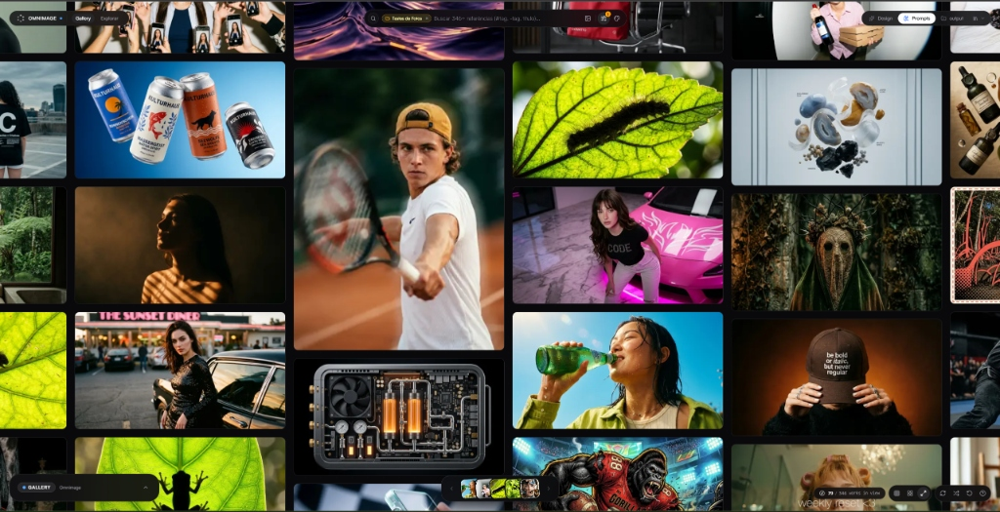
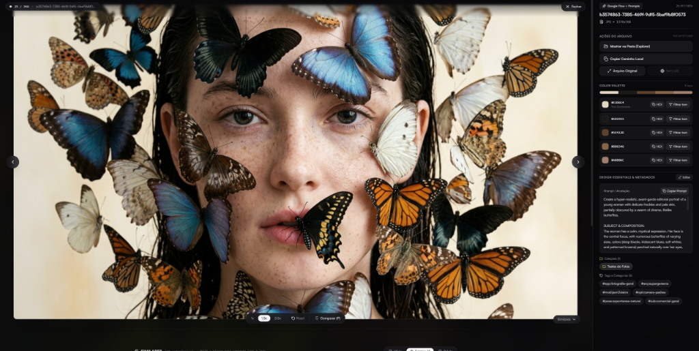

# Omnimage

**Omnimage** is a local-first, 120 FPS spatial visual catalog and semantic search engine for large reference libraries (40,000+ images and videos).

<p align="center">
  
</p>

Licensed under the [MIT License](./LICENSE).

---

## Features

<p align="center">
  


https://github.com/user-attachments/assets/75053c9e-3d9e-494c-9a5d-d9fabaa10dc7


  
</p>

- **2D Spatial Infinite Grid (120 FPS):** $O(\log N)$ viewport virtualization with instant pan/zoom and masonry explore feed.
- **Perceptual Color Harmonization & Grade Mode (Split Toning):** Multi-color filtering and radial sorting in perceptual **CIELAB (D65) + HSL** space, including the new **Grade Mode** for shadows and highlights color grading matching with clipping and letterbox rejection.
- **Local Semantic & Visual Search (CLIP):** On-device text-to-image and image-to-image similarity search powered by `Xenova/clip-vit-base-patch32` with Int8 vector quantization (512 bytes per item).
- **Zero-Lock-In Local Storage:**
  - Indexes any local folder into structured `.library` containers (via instant NTFS/POSIX hardlinks or file copy) with 640px WebP thumbnails and 5-color palettes.
  - Native zero-copy importer for existing `.library` collections.
  - Dual-write persistence: **SQLite (WAL + FTS5)** full-text search index + JSON sidecars (`.omnimage/`).
- **ComfyUI Metadata Inspector:** Automatically extracts positive/negative prompts, seed, sampler, steps, CFG, checkpoint, and full workflow JSON from ComfyUI PNG chunks (`tEXt` / `iTXt`).
- **Side-by-Side Comparison:** Compare two references with automatic prompt diffing, tag diffing, and perceptual palette delta ($\Delta E$).
- **Desktop & Web Modes:** Runs as a standalone Electron desktop app (using the privileged `omnimage-media://` zero-socket streaming protocol and native drag-and-drop) or in any modern browser.

---

## What's New

### New: Grade mode
A new similarity mode, next to Mixed, AI Aesthetic and Palette. Pick an anchor image and find images with a similar color grade: the tint in the shadows and in the highlights, not just the overall palette.

- Shadows are compared with shadows, highlights with highlights, so looks like teal & orange can be told apart from the reverse.
- Pure blacks, blown-out whites and near-neutral pixels are ignored, so things like letterbox bars don’t wash out the result.
- Works best with anchors that have a clear grade. With a very neutral anchor, it will favor other neutral images.

#### Upgrading
This update adds a new column to the library database, and existing images are analyzed in batches from their thumbnails. Back up your library before updating.

#### Thanks
This came from a great suggestion by @ichelpark.

---

## Getting Started

### Prerequisites

- **Node.js** 20+ (Node 22/24 recommended)
- **npm** 10+

### Installation

```bash
npm install
```

### Development (Web + Local Backend)

```bash
npm run dev
```

Opens at `http://localhost:5173` with the integrated SQLite + CLIP API middleware.

### Desktop Application (Electron)

```bash
# Run in desktop mode
npm run desktop

# Package Windows installer / portable executable
npm run desktop:build
```

### Running Tests

```bash
npm test
```

---

## Architecture Overview

```text
omnimage/
├── electron/               # Electron main process, preload IPC & omnimage-media:// protocol
├── server/                 # Node.js backend, SQLite FTS5 repository, CLIP service, watcher & importers
├── src/
│   ├── components/         # Spatial canvas, fullscreen inspector, comparison sidebar & taxonomy UI
│   ├── contracts/          # Data schemas & ICatalogProvider interface
│   ├── core/               # CIELAB color clustering, infinite grid math, prompt/palette diffing
│   ├── hooks/              # Canvas physics, Web Worker color sorting & keyboard navigation
│   ├── providers/          # ElectronIpcProvider, LocalHttpProvider & WebOpfsProvider
│   ├── services/           # Semantic & visual similarity ranking services
│   └── workers/            # Off-main-thread color harmonization Web Worker
└── tests/                  # Mathematical parity & backend integration test suites
```

---

## License

MIT © Omnimage Team. See [LICENSE](./LICENSE) and [THIRD-PARTY-NOTICES.md](./THIRD-PARTY-NOTICES.md) for details.
